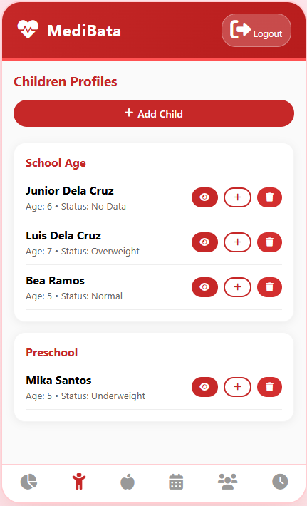
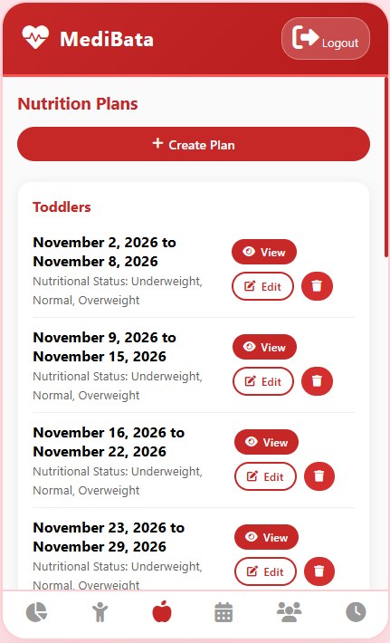
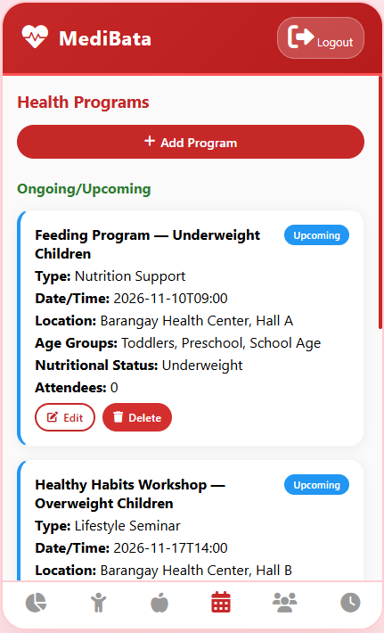

# MediBata: Children's Nutritional Planning Mobile App

<table border="0">
  <tr>
    <td valign="top" width="20%">
      
    </td>
    <td valign="top" width="80%">
      <p>MediBata is a mobile application that helps Barangay Health Workers (BHWs) and parents living in Mapaniqui, Pampanga monitor children's nutrition levels and receive diet recommendations. It addresses malnutrition and obesity among children aged 2–17 through logging BMI records, providing appropriate nutrition plans and announcement notifications of barangay health programs for children.</p>
    </td>
  </tr>
</table>

## 1. Key Features

**For a detailed guide, view the user manual:**  [Medibata User Manual](/assets/usermanual.pdf)

### Barangay Health Workers (Admin)
1.	Manage children’s profiles and log height and weight records.
2.	Calculate their BMI and automatically classify their nutritional status.
3.	Publish weekly nutrition plans according to children’s nutritional status.
4.	Publish announcements for barangay programs for pediatric healthcare.
5.	Verify registration of parent accounts and link them to children’s health records.
6.	View statistics on children’s health records and registered parent accounts.

### Parents (Users)
1.	Register for a user account.
2.	View their children’s profile and nutritional status.
3.	View personalized weekly nutrition plans for their children.
4.	Receive health program announcements.
5.	Update their children's profile and measurements with photo evidence.

<p align="left">
  
  
</p>

<p align="left">
  
  
</p>

## 2. Tech Stack

| Layer | Technologies |
|---|---|
| **Frontend** | HTML, CSS, JavaScript |
| **Database** | SQLite |
| **APK Build Tool** | Gradle |

## 3. Installation

**MediBata Mobile App**

1. Locate the executable APK in "android/app/build/outputs/apk/app-depug.apk"
2. Simply download and open the APK to run the app
 
For developers, please follow the procedures for project installation and APK configuration:

### 3.1. Prerequisites
Please download the following:
- Java SDK 21
- Android SDK

### 3.2. Installation

```bash
git clone https://github.com/prionarie/medibata.git
cd medibata
npm install
```

### 3.3. Running the App

- Open `www/index.html` directly in a browser or run:

```bash
npx serve www
```

### 3.4. Build Android APK

- Synchronize project files before building:

```bash
    npx cap sync android
```

- Build APK

```bash
    cd android
    ./gradlew assembleDebug
```
- The APK is written to `android/app/build/outputs/apk/debug/`.
- SQLite is used as the local database for offline data storage.
- Option: remove sample data seed in adapter.js.

## 4. License & Copyright

### Copyright
© 2026 MediBata. All rights reserved.

This project was developed by students of Bachelor of Science in Information Technology under Bulacan Agricultural State College as part of an academic requirement for IT 321.

The system is intended for implementation and use by the Barangay Health Center of Mapaniqui, Pampanga, subject to approval and coordination with the developers.

### License
This software is a proprietary academic-developed system.

- It may be used, installed, and deployed only by the Barangay Health Center of Mapaniqui, Pampanga, with permission from the developers.
- Redistribution, modification, or commercial use by other parties is strictly prohibited without written consent from the development team.
- The source code remains the intellectual property of the developers unless formally transferred through written agreement.
