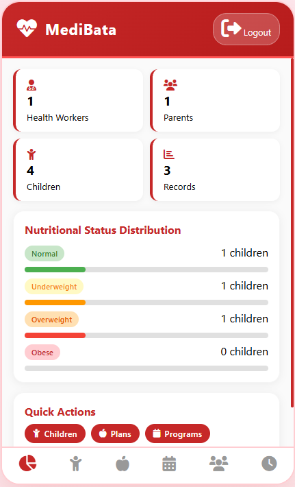

# MediBata: Children's Nutritional Planning Mobile App

<table border="0">
  <tr>
    <td valign="top" width="20%">
      
    </td>
    <td valign="top" width="80%">
      <p>MediBata is a mobile application developed for Mapaniqui Health Center in Mapaniqui, Pampanga. It helps Barangay Health Workers (BHWs) and parents monitor children's nutrition levels and receive diet recommendations. It addresses malnutrition and obesity among children aged 2–17 through logging BMI records, providing appropriate nutrition plans and announcement notifications of barangay health programs for children.</p>
    </td>
  </tr>
</table>

## 1. Key Features

**For a detailed guide, please view the user manual:**  [Medibata User Manual](/doc/usermanual.pdf)

### Barangay Health Workers (Admin)
1.	Manage children’s profiles and log height and weight records.
2.	Calculate their BMI and automatically classify their nutritional status.
3.	Publish weekly nutrition plans according to children’s nutritional status.
4.	Publish announcements for barangay programs for pediatric healthcare.
5.	Verify registration of parent accounts and link them to children’s health records.
6.	View statistics on children’s health records and registered parent accounts.

### Parents (Users)
1.	Register for a user account.
2.	View their children’s profile and nutritional status.
3.	View personalized weekly nutrition plans for their children.
4.	Receive health program announcements.
5.	Update their children's profile and measurements with photo evidence.

<p align="left">
  
  
</p>

<p align="left">
  
  
</p>

## 2. Tech Stack

| Layer | Technologies |
|---|---|
| **Frontend** | HTML, CSS, JavaScript |
| **Database** | SQLite |
| **APK Build Tool** | Gradle |

## 3. Installation

#### Mobile App
> Locate and download the executable APK in `android/app/build/outputs/apk/app-depug.apk` to install and run the app.
 
For developers, please follow the procedures for project installation and APK configuration:

### 3.1. Prerequisites
- Git
- Node.js
- Java SDK 21
- Android SDK


### 3.2. Setup

```bash
git clone https://github.com/prionarie/medibata.git
cd medibata
npm install
```

### 3.3. Running the App

- Open `www/index.html` directly in a browser or run:

```bash
npx serve www
```

### 3.4. Building the Android APK

- Synchronize project files before building:

```bash
    npx cap sync android
```

- Build APK

```bash
    cd android
    ./gradlew assembleDebug
```
- The APK is written to `android/app/build/outputs/apk/debug/`.
- SQLite is used as the local database for offline data storage.
- Option: remove sample data seed in adapter.js.

## 4. Challenges and Recommendations

This was the first mobile application we built. Initially, we were leaning towards using mobile-native programming languages like Kotlin or Flutter. However, we considered the application should be usable on desktop devices as spreadsheet applications were the primary tool for recording children's health data. Development was within a limited timeframe of one month so the application was built web-first with HTML/CSS/JS and wrapped for mobile dimensions and accessed via WebView.

Currently, the mobile application's database relies on one device and can only be updated by one person at a time. This is suitable for the setting of Brgy. Mapaniqui Health Center. However, to be fully scalable on an organizational level, migrating the app from SQLite offline storage to a synchronized database hosted on the cloud (i.e. Firebase) is recommended.

As mentioned before, adapting the application for mobile-native tools will also benefit the system in terms of increased performance on target devices and a more efficient database, in both storage and performance.

## 5. License & Copyright

### Copyright
© 2026 MediBata. All rights reserved.

This project was developed by students of Bachelor of Science in Information Technology under Bulacan Agricultural State College as part of an academic requirement for IT 321: Application Development and Emerging Technologies.

The system is intended for implementation and use by the Barangay Health Center of Mapaniqui, Pampanga, subject to approval and coordination with the developers.

### License
This software is a proprietary academic-developed system.

- It may be used, installed, and deployed only by the Barangay Health Center of Mapaniqui, Pampanga, with permission from the developers.
- Redistribution, modification, or commercial use by other parties is strictly prohibited without written consent from the development team.
- The source code remains the intellectual property of the developers unless formally transferred through written agreement.
